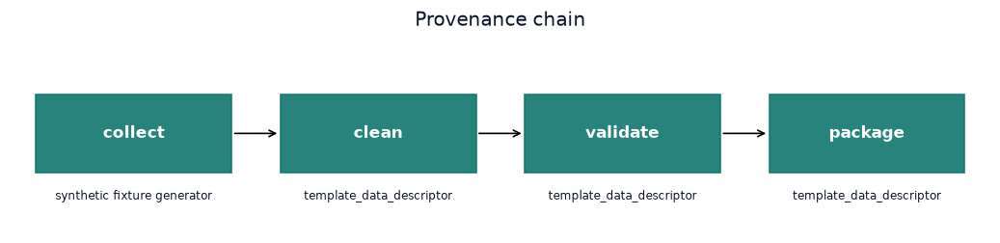

# Provenance {#sec:provenance}

The descriptor records each step in order and names its responsible agent.
The W3C PROV model provides a broader vocabulary for describing entities,
activities, and agents [@moreau2013prov].

{#fig:provenance_flow fig-alt="Flowchart from collecting fixtures through cleaning, validation, and packaging."}

## Methods

1. **Collect.** Generate synthetic measurement and subject tables.
2. **Clean.** Normalize identifiers and bound the measurement range.
3. **Validate.** Check the descriptor and reconcile its inventory with the files.
4. **Package.** Emit the metadata-only release manifest.

The descriptor records the first two steps as fixture provenance. The
standalone checkout supplies the resulting CSVs as inputs and replays
validation and packaging from those bytes. The validator reports a warning
when fewer than two provenance steps are declared. When adapting the
template, name the concrete tools, versions, operators, and inputs used to
create the files being released.
