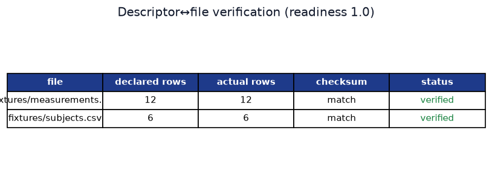

# Quality validation {#sec:quality}

Structural validation checks descriptor declarations. Byte verification
compares the inventory with the available files. Each check yields its own
evidence.

## Structural checks and negative control

`validate_descriptor()` returns severity-tagged findings for problems such
as missing required keys, unsafe or duplicate paths, malformed checksums,
malformed fields, inconsistent constraints, missing primary keys, and a
thin provenance chain. The readiness score penalizes errors and warnings
from these structural checks.

The quality gate figure compares the example descriptor with a copy
modified by `demo_broken_descriptor()`. The copy drops the license, changes
a checksum to an invalid value, sets one row count to zero, and removes a
measurement unit.

{#fig:quality_gate fig-alt="Bar chart showing no findings on the fixture and errors and warnings on the broken descriptor."}

## Checking the file inventory

`verify_descriptor_files()` recomputes the SHA-256 digest and data-row
count for each accessible file. It reports `verified`, `checksum_mismatch`,
`row_mismatch`, `unsupported_media`, `unsafe_path`, or `absent`. A file
omitted from a metadata-only release remains absent until the recipient
obtains the bytes through the appropriate channel.

{#fig:checksum_verification fig-alt="Table of declared and recomputed rows and matching checksums for the two fixture files."}

## Release review

`build_release_bundle_manifest()` assembles a JSON-ready record with the
schema fingerprint, full descriptor hash, file digests and row counts,
field constraint summaries, provenance, and the structural readiness
verdict. The manifest uses descriptor metadata. Use the separate file
verification results to confirm whether the local bytes match it.

The tests cover descriptor validation, order-independent schema fingerprints,
checksum and row-count mismatch controls, figure-data preparation, and
end-to-end generation of PNGs and release artifacts.
